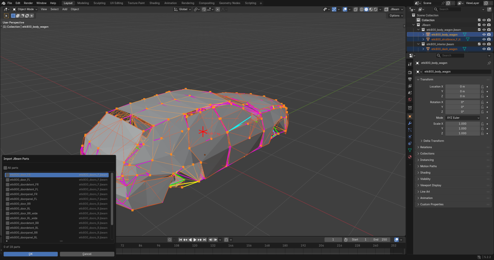
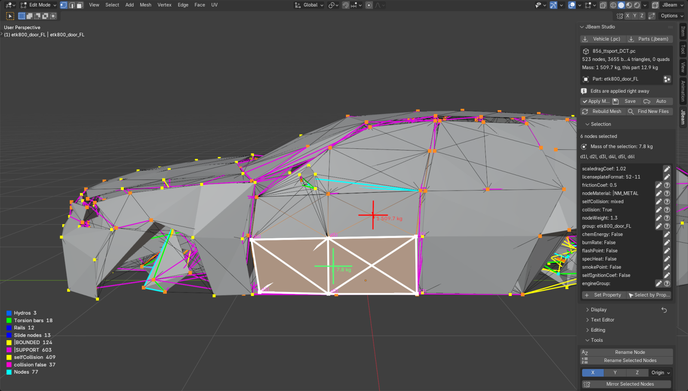
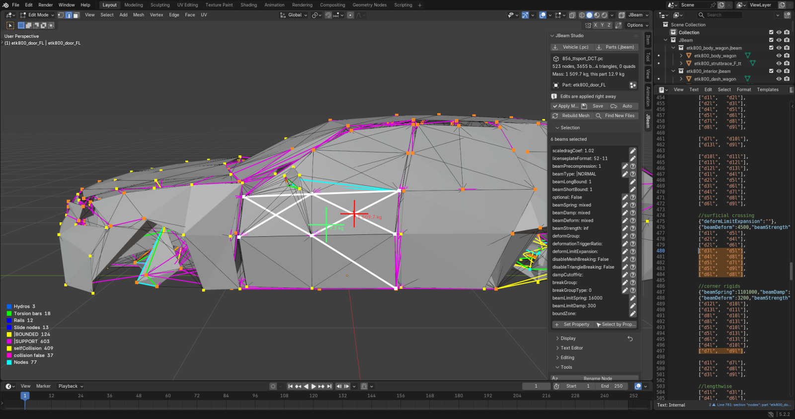
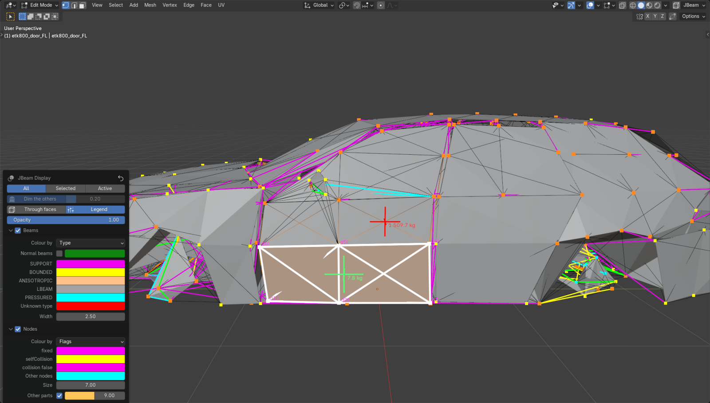

<h1 align="center">JBeam Studio</h1>

<p align="center">
  <b>Edit BeamNG.drive vehicles in Blender.</b><br>
  Nodes, beams, triangles, hydros and rails as a mesh, every change written straight back into the JBeam files.
</p>

<p align="center">
  
  
  
  <a href="https://github.com/vohhu/jbeam-studio/actions/workflows/core-tests.yml"></a>
</p>

<p align="center"><b>English</b> · <a href="README.ru.md">Русский</a></p>


JBeam Studio imports a whole vehicle from its part config (`.pc`) or single parts of `.jbeam` files, lets you edit them with Blender's modelling tools, and writes the edits back. Only the values and rows you changed are touched: formatting, comments, expressions and everything else stay as they were. It is an unofficial rewrite of BeamNG's [Blender JBeam Editor](https://github.com/BeamNG/Blender-JBeam-Editor).

## Contents

- [Features](#features)
- [Install](#install)
- [Quick start](#quick-start)
- [Guide](#guide): [importing](#importing), [editing](#editing-in-edit-mode), [new nodes and rows](#new-nodes-and-rows), [mirroring](#mirroring), [properties, groups, hydros and rails](#properties-groups-hydros-and-rails), [saving and undo](#saving-and-undo), [text editor](#text-editor), [display](#display), [diagnostics](#diagnostics), [many parts at once](#many-parts-at-once)
- [Troubleshooting](#troubleshooting)
- [Development](#development)
- [Credits and license](#credits-and-license)

## Features

| | |
|---|---|
| **Vehicles and parts** | Import a `.pc` vehicle, with its parts assembled exactly like the game's loader (slots, variables, `$=` expressions, modifiers, common parts), or any parts of any `.jbeam` files. Each part becomes its own object. |
| **Real mesh editing** | Every vertex is a node, every edge a beam, every face a triangle or quad. Move, extrude, duplicate, subdivide, merge, delete and flip; each edit reaches the JBeam text as soon as the tool finishes. |
| **Text stays yours** | Edits change only the values and rows they touch. Variables and expressions can be kept when moving nodes. The first save keeps a `.bak` of the original. |
| **Game colours** | Beams by type, nodes by flags, hydros, torsion bars and rails drawn with the colours of the game's debug view, plus gradients by `beamSpring`, `beamDamp`, `beamDeform` and `beamStrength`, and break and deform groups. |
| **Smart helpers** | New nodes are named after their neighbours (`e3l` gives `e5l`), mirroring across X, Y or Z with the side letters swapped, property editing for many rows at once, node groups, hydros, torsion bars, rails and slide nodes. |
| **Text editor** | JBeam syntax colours, problems underlined as you type, the rows of the selection highlighted, and clicking a row selects it in the viewport. |
| **Diagnostics** | Missing nodes, repeated beams, flat faces, leaking modifiers, nodes defined by two parts: listed, marked in the viewport, and fixed with one click. |
| **Fast** | A whole vehicle imported part by part (hundreds of objects) stays smooth: drawing is kept on the GPU and the parts share edits lazily. |
| **Two languages** | The interface follows Blender's language: English or Russian. |

<table>
  <tr>
    <td></td>
    <td></td>
  </tr>
  <tr>
    <td align="center"><code>beamSpring</code>, white to red as in the game</td>
    <td align="center">Break groups, in the colours of the game</td>
  </tr>
</table>

## Install

Blender 4.5 LTS or 5.2 LTS.

1. Download `jbeam_studio-<version>.zip` from [Releases](https://github.com/vohhu/jbeam-studio/releases).
2. In Blender: *Edit › Preferences › Get Extensions*, the menu in the top right corner, *Install from Disk…*, choose the zip. A newer zip installs over the old one.
3. In the add-on's preferences set *Unpacked game vehicles* to the `vehicles` folder of unpacked game content. Mods are then assembled with the game's common parts, and nodes of other vehicles are found.
   The add-on can unpack them for you: set *Game vehicle archives* to `BeamNG.drive/content/vehicles`, choose a folder in *Unpack into*, and press *Unpack Vehicles*.

## Quick start

1. *File › Import › JBeam Vehicle (.pc)*, or the buttons in the **JBeam** tab of the sidebar (N), and choose a part config such as `vehicles/etk800/856_ttsport_DCT.pc`.
2. Every part of the vehicle is selected: press Tab to edit them all, or click one part first.
3. Move nodes (G), extrude (E), join two nodes with a beam (F), delete (X). The JBeam text follows every step.
4. Press **Save**, or turn on **Auto** next to it to save after every change.
5. Open the game and reload the vehicle (Ctrl+R).

## Guide

### Importing

- **Vehicle (.pc)**: the vehicle is assembled like the game does it, with its slots, variables and the parts of `vehicles/common`. Everything goes into a **JBeam** collection, with a collection for each `.jbeam` file and an object for each part that has nodes, beams or faces.
- **Parts (.jbeam)**: choose one or several files (Shift or Ctrl in the file browser), then tick the parts in the list (dragging over the boxes ticks several) or *All parts*, which leaves out parts without nodes, beams or faces.

  

- An object shows the nodes, beams and faces of its part. Nodes of other parts that its beams use are drawn as orange points and cannot be moved or deleted there. *All vehicle nodes* (the button next to the part's name) shows every node of the vehicle, to join new beams to any of them.
- Whatever you add in an object goes to its part, and an edit in one part shows up in the others right away.

### Editing in Edit Mode



- Vertices are nodes, edges are beams, faces with three or four corners are triangles and quads. Edges that are only face sides are not beams.
- Every tool is applied when it finishes (*Editing › Apply right away*); the mesh is rebuilt from the files when you leave Edit Mode.
- *Editing › Moving nodes*: **Overwrite coordinates** (default) writes plain numbers; **Keep expressions** keeps `$variables` and `$=` expressions and adds the shift to them.
- Subdividing a face replaces its row with the rows of the new faces, which keep its properties; the faces around it, which Blender gives a point on their edge, stay as they were.
- Several parts in Edit Mode together are applied together.

### New nodes and rows

- A new node is named after the node it was extruded or copied from, or the node it is joined to: the same prefix, the next free number of that part and the side letter of its position. Extruding `e3l` gives `e5l`, `e5r` on the other side, `e5` at the centre. Nodes without neighbours get the *New node prefix* and a number.
- If an imported part already uses that name, the panel says so and the node is marked in red (see [many parts at once](#many-parts-at-once)).
- *Editing › Where new rows go*:
  - **End of table** (default): after the resets at the end of the section;
  - **Next to the source**: an extruded node after its source node, with its group and values; its beam after the beams of that node; a copied beam after the original;
  - **Into a group**: into the chosen node group, or a new `{"group": …}` block.

### Mirroring

- *Tools › Mirror Selected Nodes* copies the selected nodes, with their beams, triangles and quads, to the other side of a plane across X, Y or Z, through the origin, the 3D cursor or the active node. Names are mirrored (`e3l`/`e3r` across X, `e3f`/`e3b` across Y, `rp3t`/`rp3d` across Z; the letters are set in the preferences). Counterparts that exist are moved to the mirrored place; hydros, torsion bars and rails are mirrored too.
- *Mirror Moves X / Y / Z* (Blender's mesh symmetry) moves the counterpart of a node together with it.

### Properties, groups, hydros and rails

- **Selection** shows the properties of what is selected, by select mode: nodes in vertex mode, beams in edge mode, triangles and quads in face mode. A common value, or *mixed*, for each key, with an edit button and a link to the BeamNG documentation. *Set Property* sets a key on all of them; *Select by Property* selects, for example, every beam with `beamType` `|SUPPORT`.
- **Groups** lists the node groups of the active part, or of all parts: select, hide, show, and rename a group everywhere, including the flexbodies that use it.
- **Hydros and Rails** lists hydros, torsion bars, rails and slide nodes (those that use the selected nodes, when nodes are selected). In Edit Mode add a hydro from two selected nodes, a torsion bar from four (in the order they were selected; it twists about the second and third), a rail through the selected nodes, or slide nodes on a rail. The arrow of an entry shows its properties, each with an edit button.
- **Mass**: the panel shows the mass of the vehicle and of the part (the sum of `nodeWeight`; wheels the game adds are not counted), and *Selection* the mass of the selected nodes.

### Saving and undo

- **Save** writes the changed files; the first save of a file keeps the original next to it as `<name>.bak`.
- **Auto** saves after every edit, rename, undo and redo, so the files on disk always match what you see. It is kept in the add-on preferences.
- A file changed on disk by another program is never overwritten silently: the panel offers *Reload Changed Files* or *Save Anyway*.
- Ctrl+Z and Ctrl+Shift+Z undo and redo the JBeam edits together with the mesh, in Object and in Edit Mode.

### Text editor



*Text Editor › Show Text* opens the file of the active part in Blender's text editor.

- JBeam colours: parts, sections, keys, strings, `$variables`, `$=` expressions, numbers and comments.
- Syntax errors are underlined as you type, and problems found when assembling the vehicle are underlined too; the message is shown after the line and in the editor's footer.
- *Highlight in text*: the rows of the selection are highlighted. *Follow selection* scrolls to the row of the active element and opens its file. *Select from text*: clicking a row selects its node, beam or face in Edit Mode.
- Edits typed in the text editor are listed in the panel with *Apply* and *Discard*.

### Display



Everything drawn over the objects is set in **Display** (in the sidebar) and under the **JBeam** button in the header of the 3D viewport. The settings are kept between Blender sessions; the arrow button sets them back to the defaults.

- **Show on** all JBeam objects, the selected ones or only the active part, with the others dimmed or hidden.
- **Through faces** (also the button in the header): faces hide what is behind them, except in X-ray, in wireframe and with this switch.
- **Beams** by type, by `beamSpring`, `beamDamp`, `beamDeform` or `beamStrength` (gradients: BeamNG, rainbow, cool to warm, viridis, heat or two colours of your own), or a colour for each `breakGroup`, `deformGroup` or part. *Normal beams* draws the beams without a colour of their own too. Values a row does not set come from the vehicle's options or the game's defaults, as in the game.
- **Nodes** by flags, in one colour, by group, by part or by `nodeWeight`; nodes of other parts in orange.
- **Hydros and Rails**, **Selection and Problems**, **Node Names**, **Centre of Mass** (of the active vehicle or part and, in Edit Mode, of all selected nodes, with the mass written next to it), and the **legend**.

<br clear="right">

The default colours are those of the game's debug view (`lua/vehicle/bdebugImpl.lua`), so what you see in Blender means the same as in BeamNG:

| Beams | Colour | Nodes and others | Colour |
|---|---|---|---|
| `\|NORMAL` |  | node |  |
| `\|SUPPORT` |  | `fixed` |  |
| `\|BOUNDED` |  | `selfCollision` |  |
| `\|ANISOTROPIC` |  | `collision: false` |  |
| `\|LBEAM` |  | hydros |  |
| `\|PRESSURED` |  | torsion bars |  , axis  |
| unknown type, problems |  | rails | a colour for each, from the game's jet palette |
| values | white  to red , `FLT_MAX`  | node names, centre of mass | ,  |

### Diagnostics

**Diagnostics** lists the problems found while assembling the vehicle, with their file and line (the text button opens them). Buttons above the list fix all problems of a kind as one undo step:

- **Mark Optional**: rows that reference a missing node get `"optional": true`. They are never deleted: the node may come from a part of another configuration or from a mod the add-on does not see, and with `optional` the game skips the row while the node is missing and uses it when it exists.
- **Delete Duplicate Beams**: the first row of each repeated beam stays.
- **Add Resets**: the game reads the rows of all parts as one table, so a modifier such as `{"group": "rotor"}` left at the end of one part also applies to the parts after it; a reset row sets those keys back to the game's defaults.

With *Display › Selection and Problems › Problems*, repeated beams, flat triangles and quads, and nodes whose beams lead to missing nodes are marked in red in the viewport.

### Many parts at once

- Parts imported on their own from the same files share their edits: the other parts take an edit when editing pauses (those that show what changed) or before they are edited themselves, joining it line by line with their own edits.
- A whole vehicle imported part by part stays smooth: moving a node with Auto takes a fraction of a second, and moving the view only draws what is kept on the GPU.
- Parts imported on their own only see their own nodes and the nodes they use, so a new node can get a name that another imported part already has, for example `d16l` of the front door when the rear door uses `d16l`. The panel then says which nodes and parts, and the nodes are marked in red. Parts of the same slot type, such as two variants of one door, are alternatives and do not count.

## Troubleshooting

| Problem | What to do |
|---|---|
| *Node "…" is not defined* in a single part | The part uses nodes of other parts. Set *Unpacked game vehicles* in the preferences, or import the vehicle's `.pc`. |
| The mesh shows an older state after an undo | *Rebuild Mesh* builds it again from the files; unapplied mesh edits are lost. |
| *Changed on disk* | Another program changed the file. *Reload Changed Files* takes its version, *Save Anyway* keeps yours. |
| Colours are hidden behind faces | Turn on *Through faces* in the viewport header, or use X-ray or wireframe. |
| The game does not show the change | Reload the vehicle in the game (Ctrl+R) after saving; check that the game reads the folder you edit (mods are often zipped). |

## Development

```
jbeam_studio/core      plain Python, no Blender: SJSON parser that keeps the text, vehicle assembly that mirrors
                       the game's loader, edit sessions, mesh matching, checks
jbeam_studio/blender   meshes, object settings, sessions, undo and file handlers
jbeam_studio/ui        panels, operators, viewport drawing, text editor, Russian translation
tests/core             tests of the core, run by GitHub Actions
tests/blender          tests inside Blender; gui_check.py checks a Blender window
tests/corpus           every stock vehicle of the game (with JBS_VEHICLES_DIR set)
scripts                build.ps1 builds the zip; screenshots.py takes the pictures of this README
```

```powershell
python -m pytest                                                   # core
blender -b --factory-startup --python tests/blender/run.py         # Blender (pytest from .blender-pytest)
$env:JBS_VEHICLES_DIR = "<unpacked>/vehicles"; python -m pytest tests/corpus
./scripts/build.ps1                                                # dist/jbeam_studio-<version>.zip
blender --factory-startup --python scripts/screenshots.py -- <unpacked>/vehicles docs/images viewport
```

Pytest for Blender's Python goes into `.blender-pytest`: `python -m pip install --target .blender-pytest pytest`. See [CONTRIBUTING.md](CONTRIBUTING.md) and the [changelog](CHANGELOG.md).

## Credits and license

- [Blender JBeam Editor](https://github.com/BeamNG/Blender-JBeam-Editor) by BeamNG GmbH and Angelo Matteo, the add-on this one rewrites.
- [JBeam Editor for VS Code](https://github.com/BeamNG/vscode-jbeam-editor) by BeamNG GmbH and Thomas Fischer, the source of the key documentation.
- The screenshots show the ETK 800-Series of BeamNG.drive.

JBeam Studio is not affiliated with or endorsed by BeamNG GmbH. BeamNG and BeamNG.drive are trademarks of BeamNG GmbH. MIT License, see [LICENSE.txt](LICENSE.txt).
