<h1 align="center">JBeam Studio</h1>

<p align="center">
  <b>Редактирование машин BeamNG.drive в Blender.</b><br>
  Ноды, балки, треугольники, гидравлика и рельсы как меш; каждая правка сразу записывается в JBeam-файлы.
</p>

<p align="center">
  
  
  
  <a href="https://github.com/vohhu/jbeam-studio/actions/workflows/core-tests.yml"></a>
</p>

<p align="center"><a href="README.md">English</a> · <b>Русский</b></p>

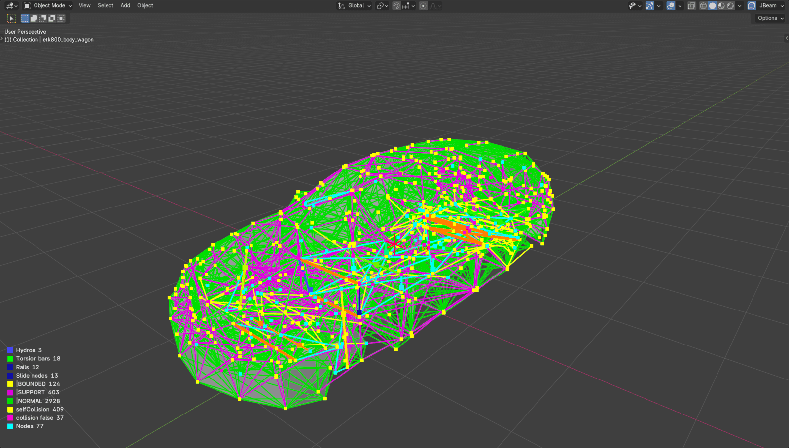

JBeam Studio импортирует машину целиком по её конфигурации (`.pc`) или отдельные части из `.jbeam`-файлов, даёт править их инструментами моделирования Blender и записывает правки обратно. Меняются только те значения и строки, которые вы правили: форматирование, комментарии, выражения и всё остальное остаются как были. Это неофициальная переработка [Blender JBeam Editor](https://github.com/BeamNG/Blender-JBeam-Editor) от BeamNG.

## Содержание

- [Возможности](#возможности)
- [Установка](#установка)
- [Быстрый старт](#быстрый-старт)
- [Руководство](#руководство): [импорт](#импорт), [правка](#правка-в-режиме-редактирования), [новые ноды и строки](#новые-ноды-и-строки), [зеркалирование](#зеркалирование), [свойства, группы, гидравлика и рельсы](#свойства-группы-гидравлика-и-рельсы), [сохранение и отмена](#сохранение-и-отмена), [текстовый редактор](#текстовый-редактор), [отображение](#отображение), [диагностика](#диагностика), [много частей сразу](#много-частей-сразу)
- [Решение проблем](#решение-проблем)
- [Разработка](#разработка)
- [Авторы и лицензия](#авторы-и-лицензия)

## Возможности

| | |
|---|---|
| **Машины и части** | Импорт машины из `.pc`, собранной точно как это делает загрузчик игры (слоты, переменные, выражения `$=`, модификаторы, общие части), или любых частей любых `.jbeam`-файлов. Каждая часть становится отдельным объектом. |
| **Настоящая правка меша** | Каждая вершина — нода, каждое ребро — балка, каждая грань — треугольник или квад. Перемещение, выдавливание, дублирование, подразделение, слияние, удаление и разворот; правка попадает в JBeam-текст, как только инструмент закончил работу. |
| **Текст остаётся вашим** | Правки меняют только те значения и строки, которых касаются. При перемещении нод можно сохранить переменные и выражения. Первое сохранение оставляет `.bak` с оригиналом. |
| **Цвета игры** | Балки по типу, ноды по флагам, гидравлика, торсионы и рельсы рисуются цветами отладочного режима игры; плюс градиенты по `beamSpring`, `beamDamp`, `beamDeform` и `beamStrength`, группы поломки и деформации. |
| **Умные помощники** | Новые ноды получают имена по соседям (`e3l` даёт `e5l`), зеркалирование по X, Y или Z с заменой букв сторон, правка свойств сразу у многих строк, группы нод, гидравлика, торсионы, рельсы и слайд-ноды. |
| **Текстовый редактор** | Подсветка синтаксиса JBeam, ошибки подчёркиваются при вводе, строки выделения подсвечиваются, а щелчок по строке выделяет её во вьюпорте. |
| **Диагностика** | Несуществующие ноды, повторяющиеся балки, плоские грани, «протекающие» модификаторы, ноды, которые задают две части: список, отметки во вьюпорте и исправление одной кнопкой. |
| **Быстро** | Машина, импортированная по частям (сотни объектов), не тормозит: отрисовка хранится на видеокарте, а части обмениваются правками лениво. |
| **Два языка** | Интерфейс следует языку Blender: английский или русский. |

<table>
  <tr>
    <td>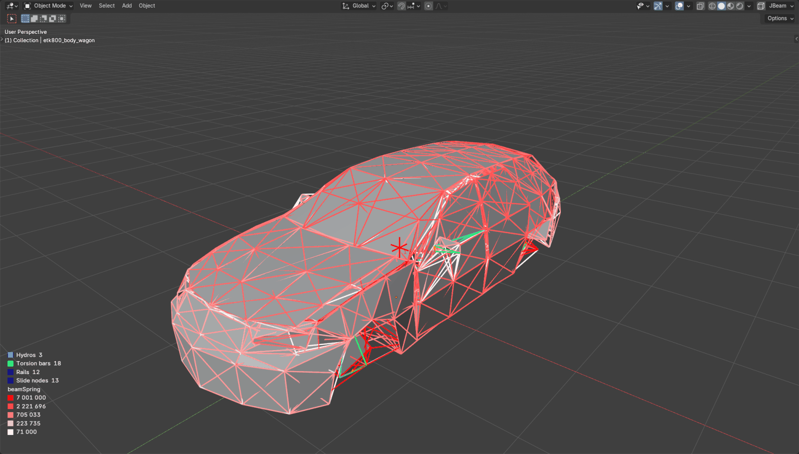</td>
    <td>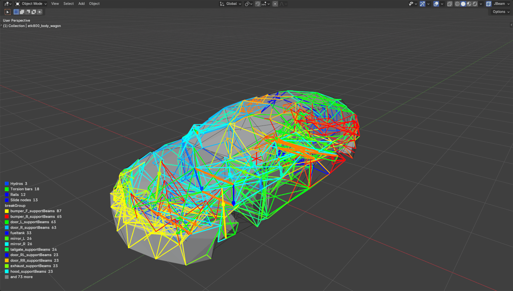</td>
  </tr>
  <tr>
    <td align="center"><code>beamSpring</code>, от белого к красному, как в игре</td>
    <td align="center">Группы поломки, цветами игры</td>
  </tr>
</table>

## Установка

Blender 4.5 LTS или 5.2 LTS.

1. Скачайте `jbeam_studio-<версия>.zip` со страницы [Releases](https://github.com/vohhu/jbeam-studio/releases).
2. В Blender: *Edit › Preferences › Get Extensions*, меню в правом верхнем углу, *Install from Disk…*, выберите zip. Новый zip ставится поверх старого.
3. В настройках аддона укажите в *Распакованные машины игры* папку `vehicles` распакованного контента игры. Тогда моды собираются вместе с общими частями игры, а ноды других машин находятся.
   Аддон может распаковать их сам: укажите в *Архивы машин игры* папку `BeamNG.drive/content/vehicles`, выберите папку в *Распаковать в* и нажмите *Распаковать машины*.

## Быстрый старт

1. *File › Import › JBeam Vehicle (.pc)* или кнопки во вкладке **JBeam** боковой панели (N); выберите конфигурацию, например `vehicles/etk800/856_ttsport_DCT.pc`.
2. Все части машины выделены: Tab открывает их все для правки, или сначала щёлкните одну часть.
3. Двигайте ноды (G), выдавливайте (E), соединяйте две ноды балкой (F), удаляйте (X). JBeam-текст следует за каждым шагом.
4. Нажмите **Сохранить** или включите **Auto** рядом, чтобы сохранять после каждой правки.
5. Откройте игру и перезагрузите машину (Ctrl+R).

## Руководство

### Импорт

- **Машина (.pc)**: машина собирается так же, как в игре, со своими слотами, переменными и частями `vehicles/common`. Всё попадает в коллекцию **JBeam**: в ней коллекция на каждый `.jbeam`-файл и объект на каждую часть, у которой есть ноды, балки или грани.
- **Части (.jbeam)**: выберите один или несколько файлов (Shift или Ctrl в файловом браузере), затем отметьте части в списке (протаскивание по флажкам отмечает несколько) или *All parts* — так пропускаются части без нод, балок и граней.

  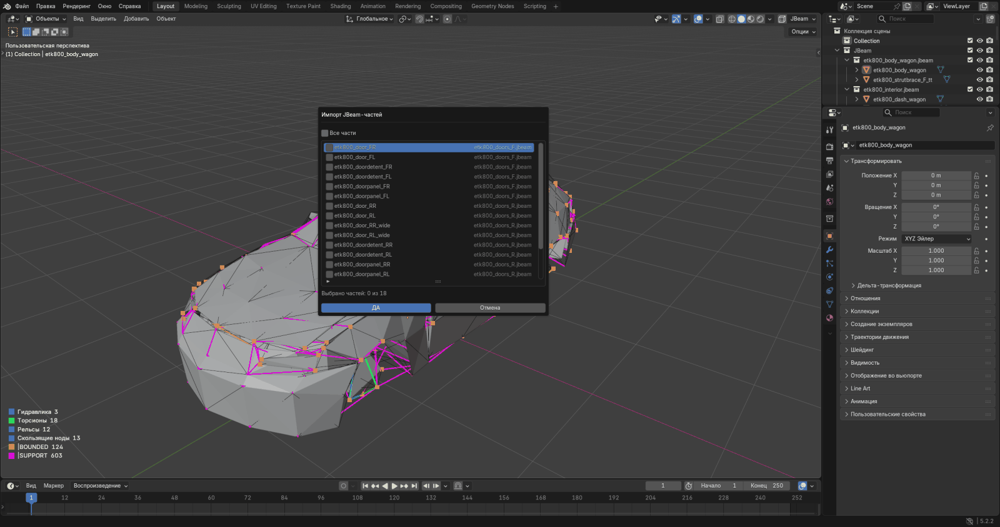

- Объект показывает ноды, балки и грани своей части. Ноды других частей, на которые ссылаются её балки, рисуются оранжевыми точками, и здесь их нельзя двигать или удалять. *Все ноды машины* (кнопка рядом с именем части) показывает все ноды машины, чтобы соединять новые балки с любыми из них.

  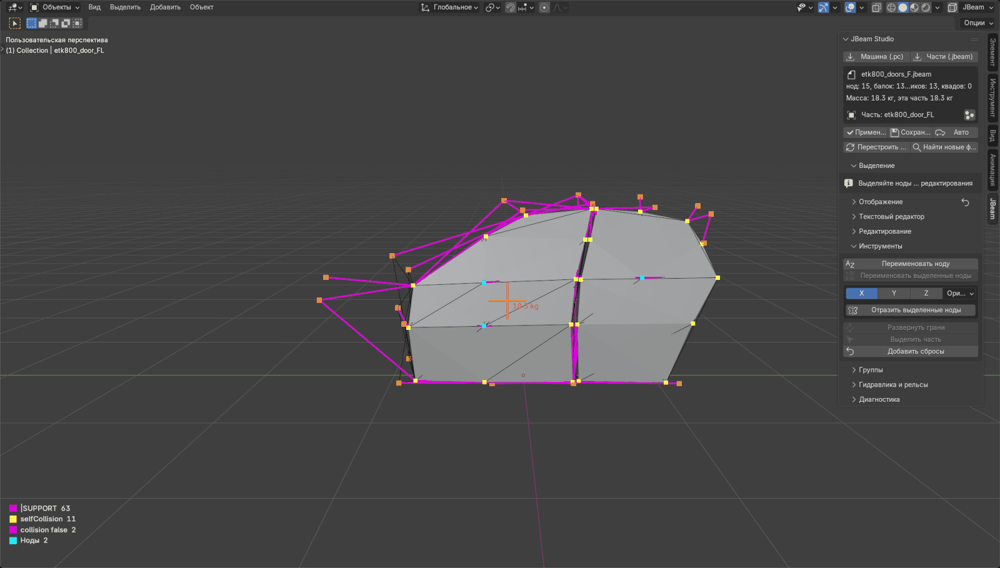
- Всё, что добавлено в объекте, попадает в его часть, а правка одной части сразу видна в остальных.

### Правка в режиме редактирования

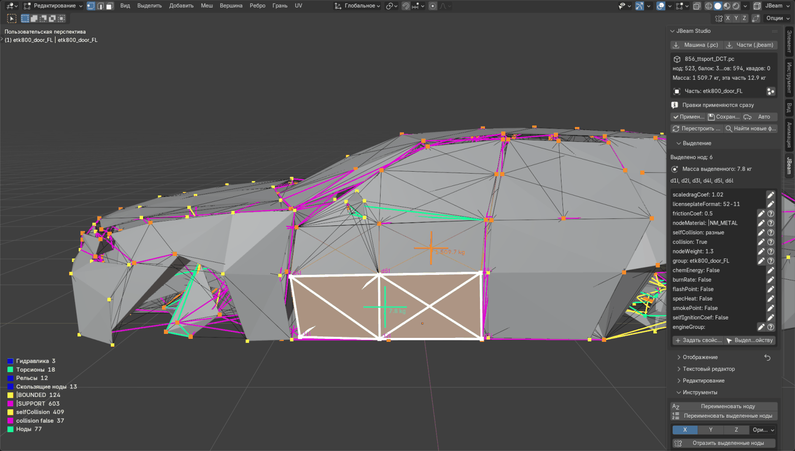

- Вершины — ноды, рёбра — балки, грани с тремя или четырьмя углами — треугольники и квады. Рёбра, которые только стороны граней, балками не являются.
- Каждый инструмент применяется, когда заканчивает работу (*Правка › Применять сразу*); при выходе из режима редактирования меш перестраивается по файлам.
- *Правка › Перемещение нод*: **Перезаписывать координаты** (по умолчанию) пишет простые числа; **Сохранять выражения** оставляет `$переменные` и выражения `$=` и прибавляет к ним сдвиг.
- Подразделение грани заменяет её строку строками новых граней, которые сохраняют её свойства; соседние грани, которым Blender добавляет точку на ребре, остаются как были.
- Несколько частей, открытых для правки вместе, применяются вместе.

<table>
  <tr>
    <td width="50%">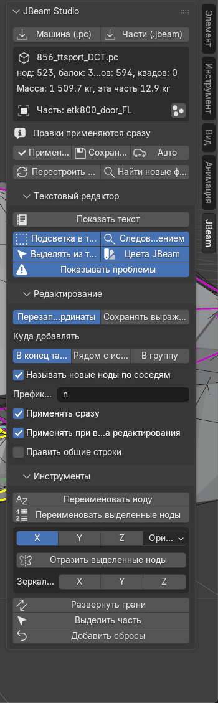</td>
    <td width="50%">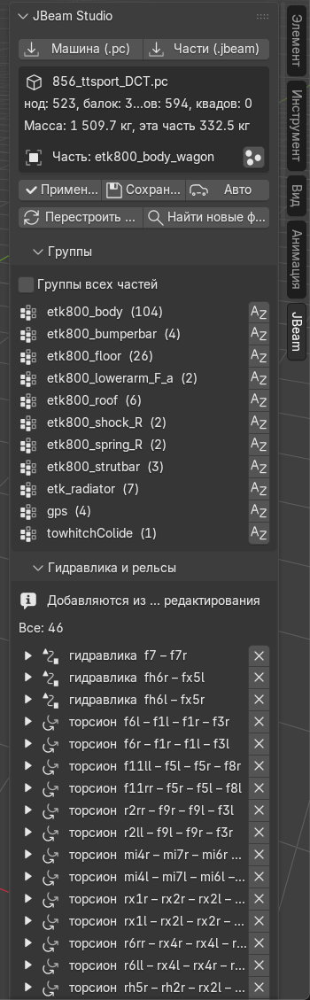</td>
  </tr>
  <tr>
    <td align="center"><i>Текстовый редактор</i>, <i>Редактирование</i> и <i>Инструменты</i></td>
    <td align="center"><i>Группы</i>, <i>Гидравлика и рельсы</i> и <i>Диагностика</i></td>
  </tr>
</table>

### Новые ноды и строки

- Новая нода получает имя по ноде, из которой её выдавили или скопировали, или к которой её присоединили: тот же префикс, следующий свободный номер этой части и буква стороны по её положению. Выдавливание `e3l` даёт `e5l`, `e5r` на другой стороне, `e5` в центре. Ноды без соседей получают *Префикс новых нод* и номер.
- Если такое имя уже есть у другой импортированной части, панель предупреждает об этом, а нода отмечается красным (см. [много частей сразу](#много-частей-сразу)).
- *Правка › Куда добавлять*:
  - **В конец таблицы** (по умолчанию): после сбросов в конце раздела;
  - **Рядом с источником**: выдавленная нода — после исходной, с её группой и значениями; её балка — после балок этой ноды; скопированная балка — после оригинала;
  - **В группу**: в выбранную группу нод или в новый блок `{"group": …}`.

### Зеркалирование

- *Инструменты › Отразить выделенные ноды* копирует выделенные ноды вместе с их балками, треугольниками и квадами на другую сторону плоскости поперёк X, Y или Z — через начало координат, 3D-курсор или активную ноду. Имена отражаются (`e3l`/`e3r` по X, `e3f`/`e3b` по Y, `rp3t`/`rp3d` по Z; буквы задаются в настройках). Существующие пары переносятся на отражённое место; гидравлика, торсионы и рельсы отражаются тоже.
- *Зеркалить перемещения X / Y / Z* (симметрия меша Blender) двигают пару ноды вместе с ней.

### Свойства, группы, гидравлика и рельсы

- **Выделение** показывает свойства выделенного по режиму выделения: ноды в режиме вершин, балки в режиме рёбер, треугольники и квады в режиме граней. Для каждого ключа — общее значение или *разные*, кнопка правки и ссылка на документацию BeamNG. *Задать свойство* ставит ключ всем сразу; *Выделить по свойству* выделяет, например, все балки с `beamType` `|SUPPORT`.
- **Группы** — группы нод активной части или всех частей: выделить, скрыть, показать и переименовать группу везде, включая flexbody, которые её используют.
- **Гидравлика и рельсы** — список гидравлики, торсионов, рельсов и слайд-нод (при выделенных нодах — только тех, что их используют). В режиме редактирования: гидравлика из двух выделенных нод, торсион из четырёх (в порядке выделения; он крутится вокруг второй и третьей), рельс через выделенные ноды или слайд-ноды на рельсе. Стрелка у записи раскрывает её свойства, у каждого — кнопка правки.
- **Масса**: панель показывает массу машины и части (сумма `nodeWeight`; колёса, которые добавляет игра, не считаются), а *Выделение* — массу выделенных нод.

### Сохранение и отмена

- **Сохранить** записывает изменённые файлы; первое сохранение файла оставляет рядом оригинал `<имя>.bak`.
- **Auto** сохраняет после каждой правки, переименования, отмены и повтора, так что файлы на диске всегда совпадают с тем, что вы видите. Настройка хранится в настройках аддона.
- Файл, изменённый на диске другой программой, никогда не перезаписывается молча: панель предлагает *Перечитать изменённые файлы* или *Всё равно сохранить*.
- Ctrl+Z и Ctrl+Shift+Z отменяют и повторяют JBeam-правки вместе с мешем, и в объектном режиме, и в режиме редактирования.

### Текстовый редактор

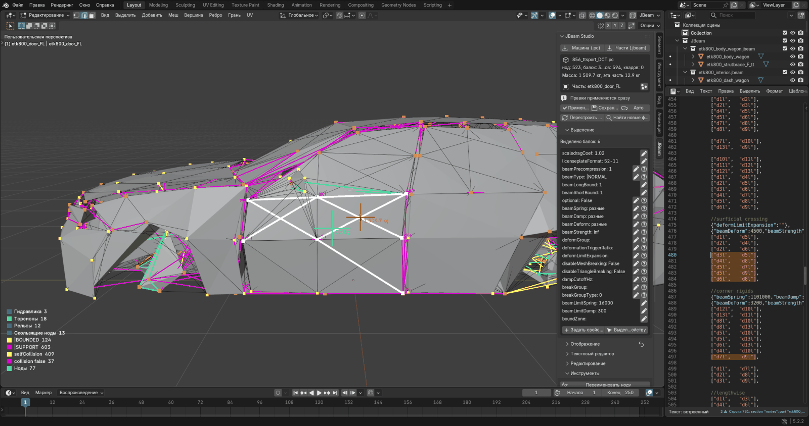

*Текстовый редактор › Показать текст* открывает файл активной части в текстовом редакторе Blender.

- Цвета JBeam: части, разделы, ключи, строки, `$переменные`, выражения `$=`, числа и комментарии.
- Синтаксические ошибки подчёркиваются при вводе, проблемы сборки машины — тоже; сообщение показывается после строки и в подвале редактора.
- *Подсветка в тексте*: строки выделения подсвечиваются. *Следовать за выделением* прокручивает к строке активного элемента и открывает его файл. *Выделять из текста*: щелчок по строке выделяет её ноду, балку или грань в режиме редактирования.
- Правки, набранные в текстовом редакторе, перечисляются в панели с кнопками *Применить* и *Отменить*.

### Отображение

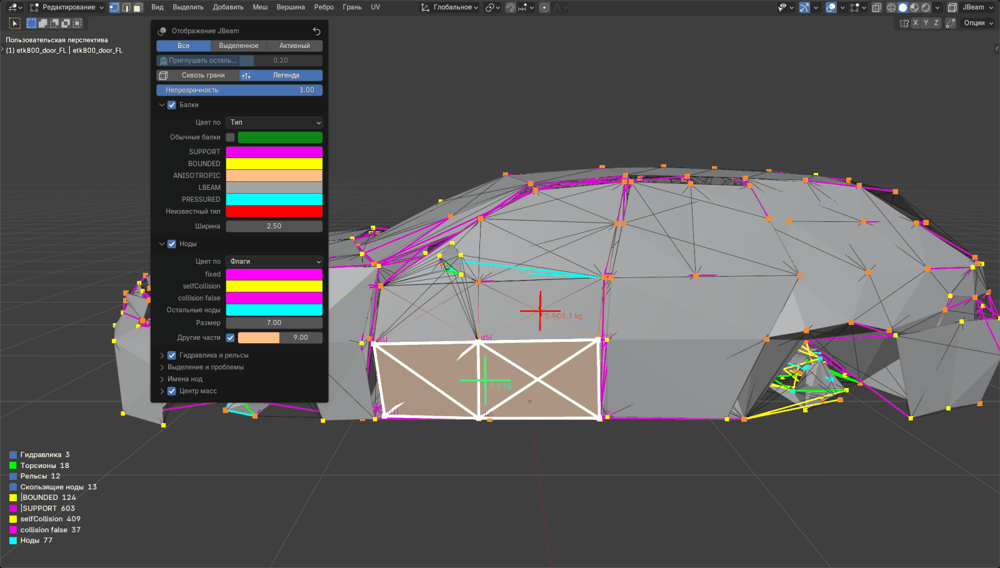

Всё, что рисуется поверх объектов, настраивается в разделе **Отображение** (в боковой панели) и по кнопке **JBeam** в шапке 3D-вьюпорта. Настройки сохраняются между запусками Blender; кнопка со стрелкой возвращает значения по умолчанию.

- **Показывать на** всех JBeam-объектах, выделенных или только на активной части; остальные приглушаются или прячутся.
- **Сквозь грани** (также кнопка в шапке): грани скрывают то, что за ними, кроме режимов X-ray и каркаса и этого переключателя.
- **Балки** по типу, по `beamSpring`, `beamDamp`, `beamDeform` или `beamStrength` (градиенты: BeamNG, радуга, холодный — тёплый, viridis, тепло или два своих цвета), или свой цвет у каждой `breakGroup`, `deformGroup` или части. *Обычные балки* рисует и балки без собственного цвета. Значения, которых нет в строке, берутся из опций машины или значений игры по умолчанию, как в игре.
- **Ноды** по флагам, одним цветом, по группе, по части или по `nodeWeight`; ноды других частей — оранжевым.
- **Гидравлика и рельсы**, **Выделение и проблемы**, **Имена нод**, **Центр масс** (активной машины или части и, в режиме редактирования, всех выделенных нод, с подписью массы) и **легенда**.

<br clear="right">

Цвета по умолчанию взяты из отладочного режима игры (`lua/vehicle/bdebugImpl.lua`), так что увиденное в Blender значит то же, что и в BeamNG:

| Балки | Цвет | Ноды и прочее | Цвет |
|---|---|---|---|
| `\|NORMAL` |  | нода |  |
| `\|SUPPORT` |  | `fixed` |  |
| `\|BOUNDED` |  | `selfCollision` |  |
| `\|ANISOTROPIC` |  | `collision: false` |  |
| `\|LBEAM` |  | гидравлика |  |
| `\|PRESSURED` |  | торсионы |  , ось  |
| неизвестный тип, проблемы |  | рельсы | у каждого свой цвет из палитры jet игры |
| значения | от белого  к красному , `FLT_MAX`  | имена нод, центр масс | ,  |

#### Как выглядят настройки

<table>
  <tr>
    <td width="50%">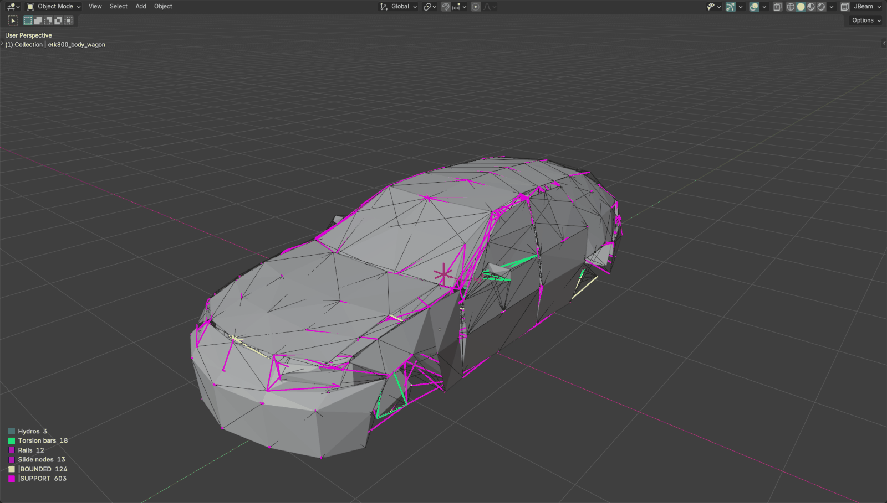</td>
    <td width="50%">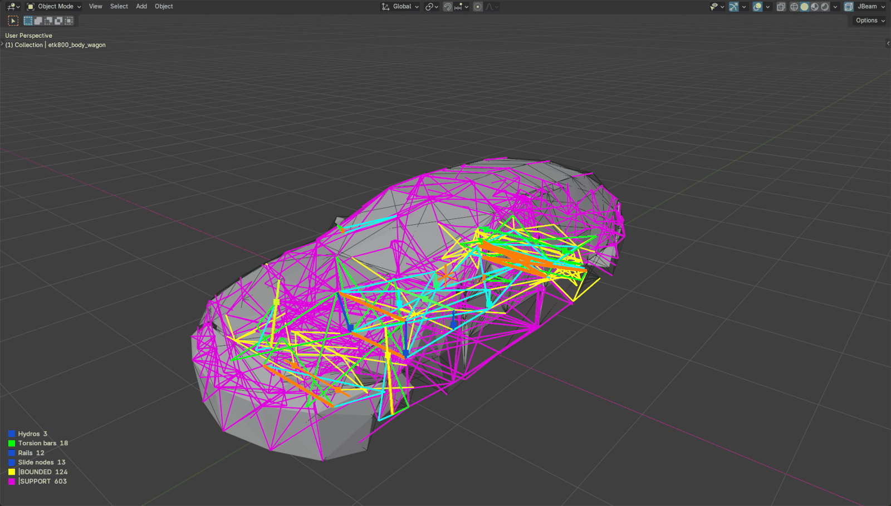</td>
  </tr>
  <tr>
    <td align="center">Балки по типу; грани скрывают то, что за ними</td>
    <td align="center">То же со <i>Сквозь грани</i></td>
  </tr>
  <tr>
    <td></td>
    <td>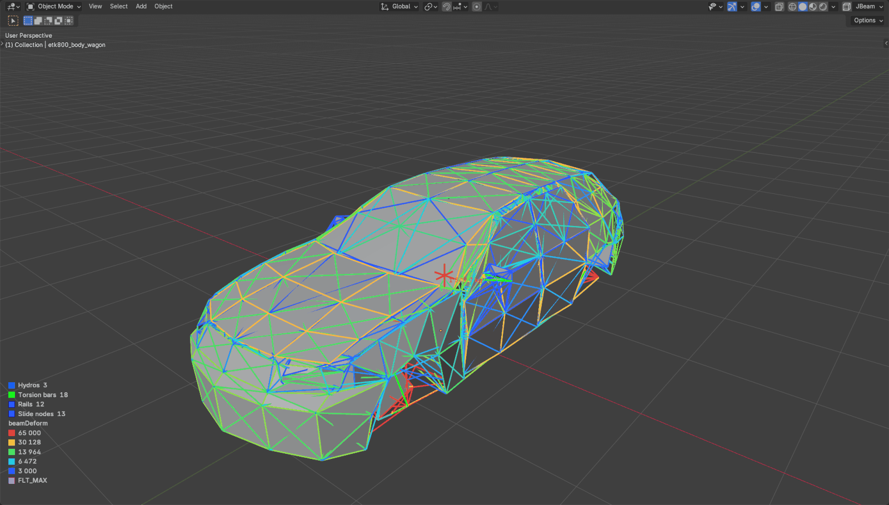</td>
  </tr>
  <tr>
    <td align="center"><code>beamSpring</code>, градиент BeamNG (от белого к красному)</td>
    <td align="center"><code>beamDeform</code>, радуга</td>
  </tr>
  <tr>
    <td>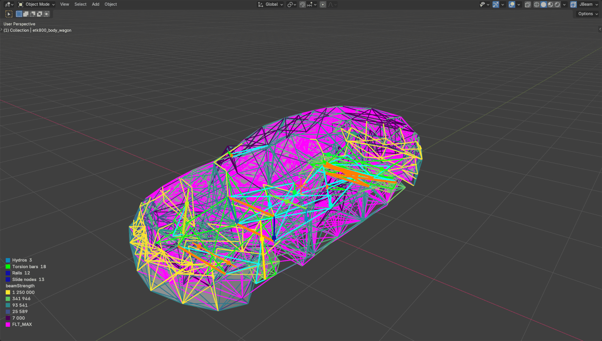</td>
    <td></td>
  </tr>
  <tr>
    <td align="center"><code>beamStrength</code>, viridis; <code>FLT_MAX</code> пурпурным</td>
    <td align="center">Свой цвет у каждой <code>breakGroup</code></td>
  </tr>
  <tr>
    <td>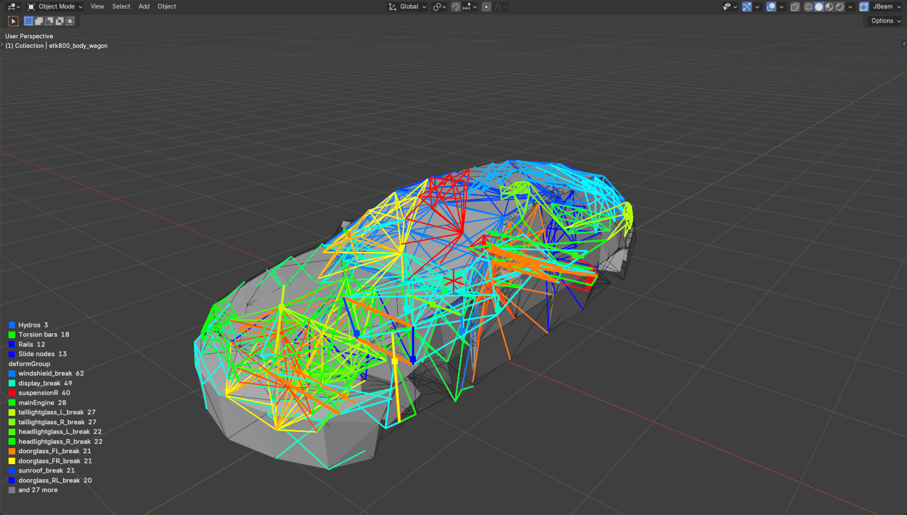</td>
    <td>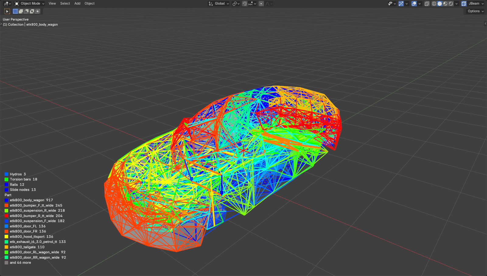</td>
  </tr>
  <tr>
    <td align="center">Свой цвет у каждой <code>deformGroup</code></td>
    <td align="center">Свой цвет у каждой части</td>
  </tr>
  <tr>
    <td>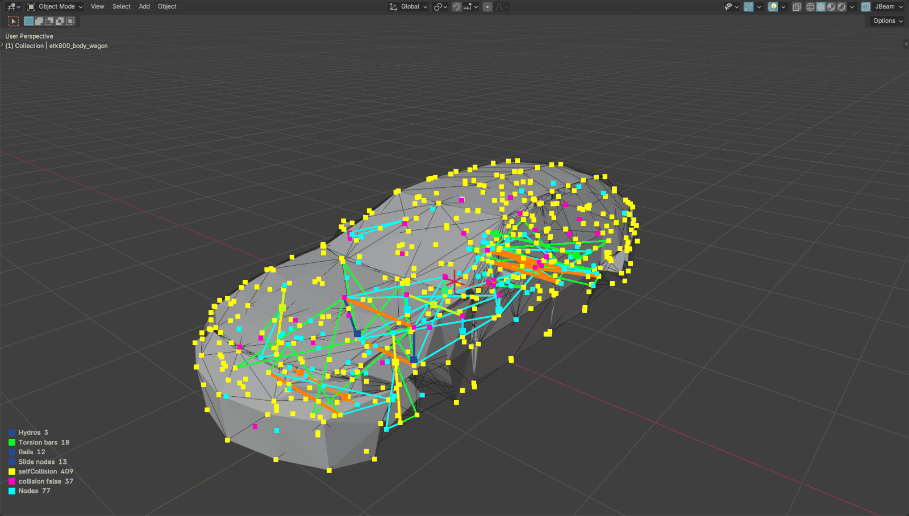</td>
    <td>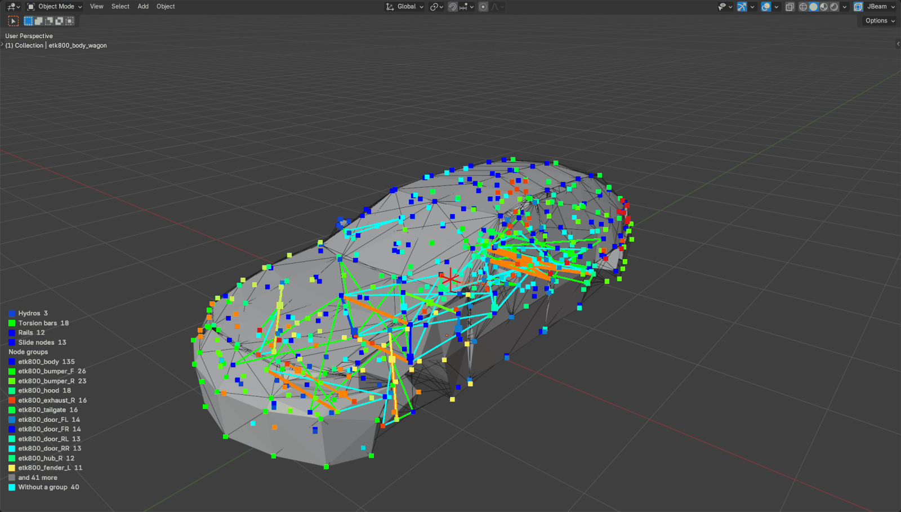</td>
  </tr>
  <tr>
    <td align="center">Ноды по флагам, как в игре</td>
    <td align="center">Ноды по группам</td>
  </tr>
  <tr>
    <td>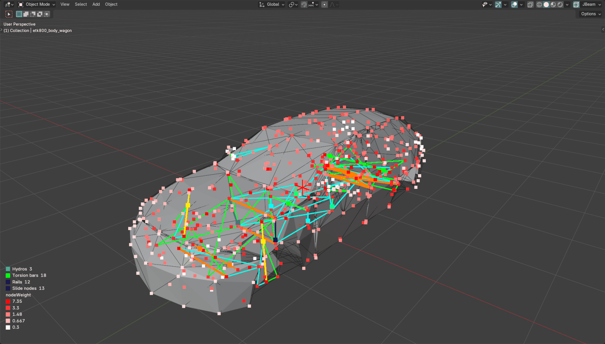</td>
    <td>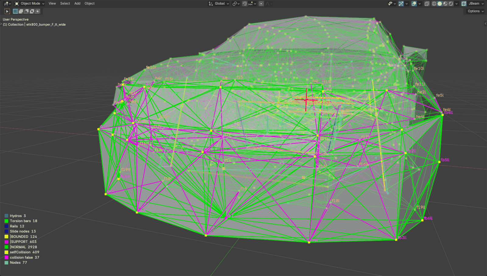</td>
  </tr>
  <tr>
    <td align="center">Ноды по <code>nodeWeight</code></td>
    <td align="center"><i>Имена нод › Все</i> у активной части, остальные приглушены</td>
  </tr>
  <tr>
    <td>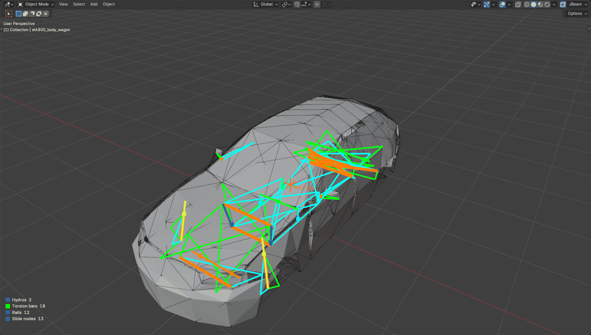</td>
    <td>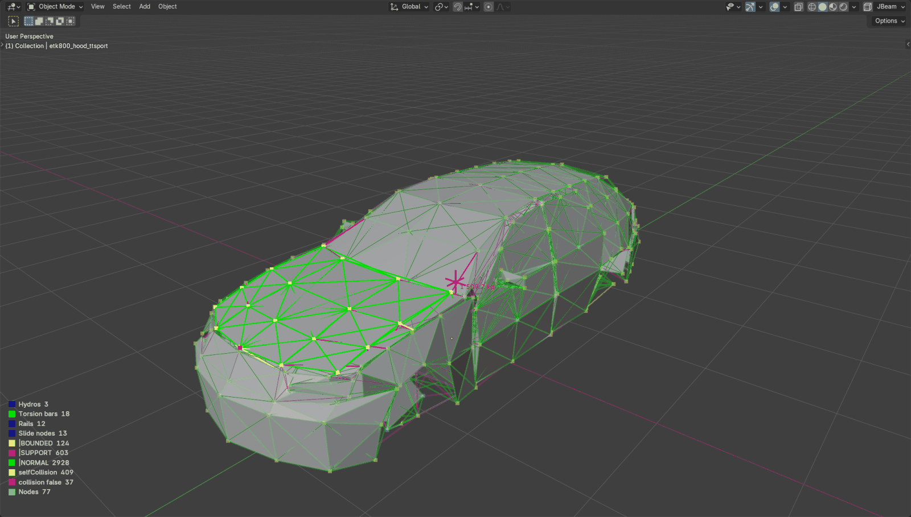</td>
  </tr>
  <tr>
    <td align="center">Гидравлика, торсионы (две половины и ось) и рельсы</td>
    <td align="center"><i>Показывать на › Активный</i>: капот, остальное приглушено</td>
  </tr>
  <tr>
    <td>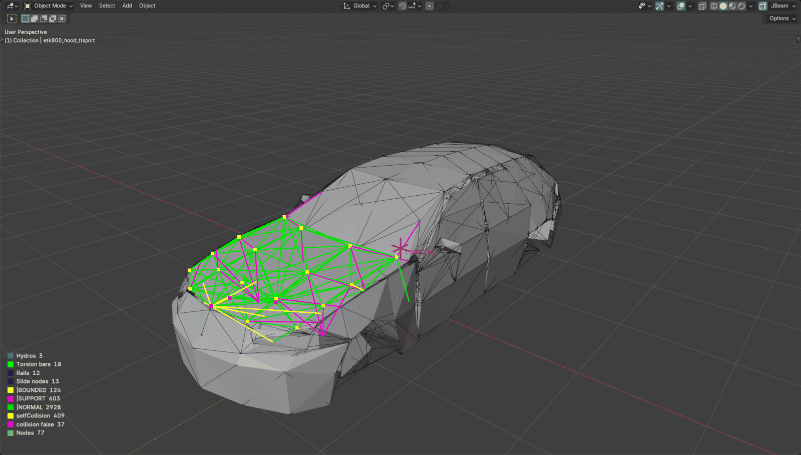</td>
    <td>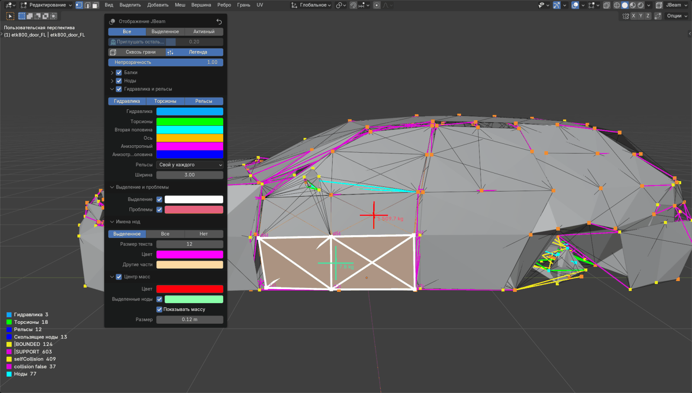</td>
  </tr>
  <tr>
    <td align="center"><i>Показывать на › Активный</i> без <i>Приглушать остальные</i></td>
    <td align="center">Гидравлика и рельсы, Выделение и проблемы, Имена нод, Центр масс</td>
  </tr>
</table>

### Диагностика

**Диагностика** перечисляет проблемы, найденные при сборке машины, с файлом и строкой (кнопка с текстом открывает их). Кнопки над списком исправляют все проблемы одного вида за один шаг отмены:

- **Пометить optional**: строки со ссылкой на несуществующую ноду получают `"optional": true`. Они никогда не удаляются: нода может прийти из части другой конфигурации или из мода, которого аддон не видит, а с `optional` игра пропускает строку, пока ноды нет, и использует её, когда нода есть.
- **Удалить повторы балок**: из каждой повторяющейся балки остаётся первая строка.
- **Добавить сбросы**: игра читает строки всех частей как одну таблицу, поэтому модификатор вроде `{"group": "rotor"}`, оставленный в конце одной части, действует и на следующие; строка сброса возвращает эти ключи к значениям игры по умолчанию.

С включённым *Отображение › Выделение и проблемы › Проблемы* повторяющиеся балки, плоские треугольники и квады и ноды, чьи балки ведут к несуществующим нодам, отмечаются во вьюпорте красным.

### Много частей сразу

- Части, импортированные по отдельности из одних и тех же файлов, обмениваются правками: остальные части забирают правку, когда правка затихает (те, что показывают изменённое), или перед собственной правкой, объединяя её со своими правками построчно.
- Машина, импортированная по частям, не тормозит: перемещение ноды с Auto занимает доли секунды, а вращение камеры только рисует то, что уже лежит на видеокарте.
- Часть, импортированная отдельно, видит только свои ноды и ноды, которые использует, поэтому новая нода может получить имя, которое уже есть у другой импортированной части, например `d16l` передней двери, когда задняя дверь использует `d16l`. Тогда панель говорит, какие ноды и части совпали, а ноды отмечаются красным. Части одного типа слота, например два варианта одной двери, — альтернативы и не считаются.

  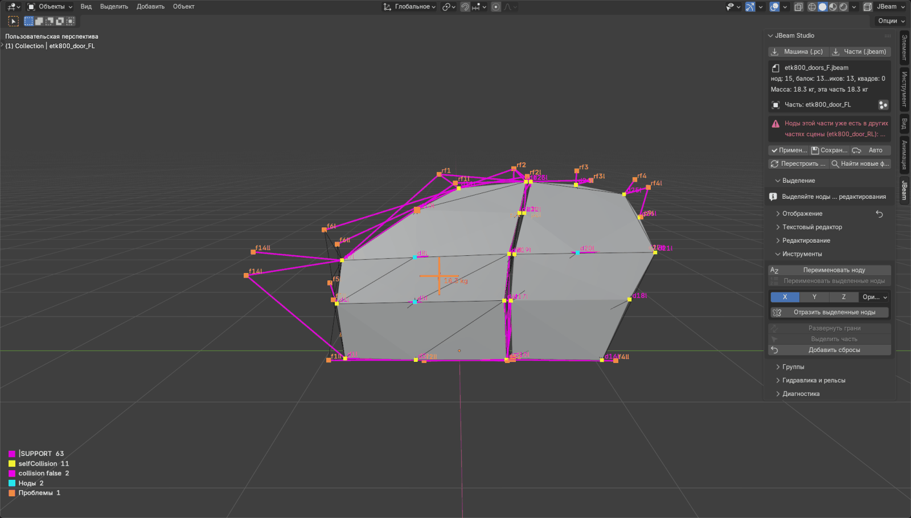

## Решение проблем

| Проблема | Что делать |
|---|---|
| *Нода «…» не найдена* в отдельной части | Часть использует ноды других частей. Укажите *Распакованные машины игры* в настройках или импортируйте `.pc` машины. |
| После отмены меш показывает старое состояние | *Перестроить меш* строит его заново по файлам; неприменённые правки меша теряются. |
| *Изменены на диске* | Файл изменила другая программа. *Перечитать изменённые файлы* берёт её версию, *Всё равно сохранить* оставляет вашу. |
| Цвета не видны за гранями | Включите *Сквозь грани* в шапке вьюпорта или используйте X-ray или каркас. |
| Игра не показывает изменение | Перезагрузите машину в игре (Ctrl+R) после сохранения; проверьте, что игра читает именно ту папку, которую вы правите (моды часто упакованы в zip). |

## Разработка

```
jbeam_studio/core      чистый Python без Blender: SJSON-парсер, сохраняющий текст, сборка машины как в загрузчике
                       игры, сессии правки, сопоставление меша, проверки
jbeam_studio/blender   меши, настройки объектов, сессии, обработчики отмены и файлов
jbeam_studio/ui        панели, операторы, отрисовка во вьюпорте, текстовый редактор, русский перевод
tests/core             тесты ядра, их запускает GitHub Actions
tests/blender          тесты внутри Blender; gui_check.py проверяет окно Blender
tests/corpus           все машины игры (при заданном JBS_VEHICLES_DIR)
scripts                build.ps1 собирает zip; screenshots.py снимает картинки для этого README
```

```powershell
python -m pytest                                                   # ядро
blender -b --factory-startup --python tests/blender/run.py         # Blender (pytest из .blender-pytest)
$env:JBS_VEHICLES_DIR = "<распаковано>/vehicles"; python -m pytest tests/corpus
./scripts/build.ps1                                                # dist/jbeam_studio-<версия>.zip
blender --factory-startup --enable-event-simulate --python scripts/screenshots.py -- <распаковано>/vehicles docs/images viewport
python scripts/shrink_images.py                                    # 256 цветов, втрое меньше
```

`screenshots.py` снимает за запуск один набор картинок (`viewport`, `editing`, `parts`, `popover`, `popover-more`, `panels-editing`, `panels-lists`, `dialog`); с `ru` — с русским интерфейсом.

Pytest для Python внутри Blender ставится в `.blender-pytest`: `python -m pip install --target .blender-pytest pytest`. См. [CONTRIBUTING.md](CONTRIBUTING.md) и [историю изменений](CHANGELOG.ru.md).

## Авторы и лицензия

- [Blender JBeam Editor](https://github.com/BeamNG/Blender-JBeam-Editor) от BeamNG GmbH и Angelo Matteo — аддон, который переработан здесь.
- [JBeam Editor for VS Code](https://github.com/BeamNG/vscode-jbeam-editor) от BeamNG GmbH и Thomas Fischer — источник документации ключей.
- На скриншотах — ETK 800-Series из BeamNG.drive.

JBeam Studio не связан с BeamNG GmbH и не одобрен ею. BeamNG и BeamNG.drive — товарные знаки BeamNG GmbH. Лицензия MIT, см. [LICENSE.txt](LICENSE.txt).
